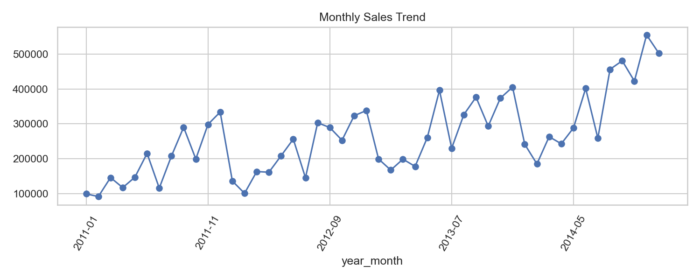
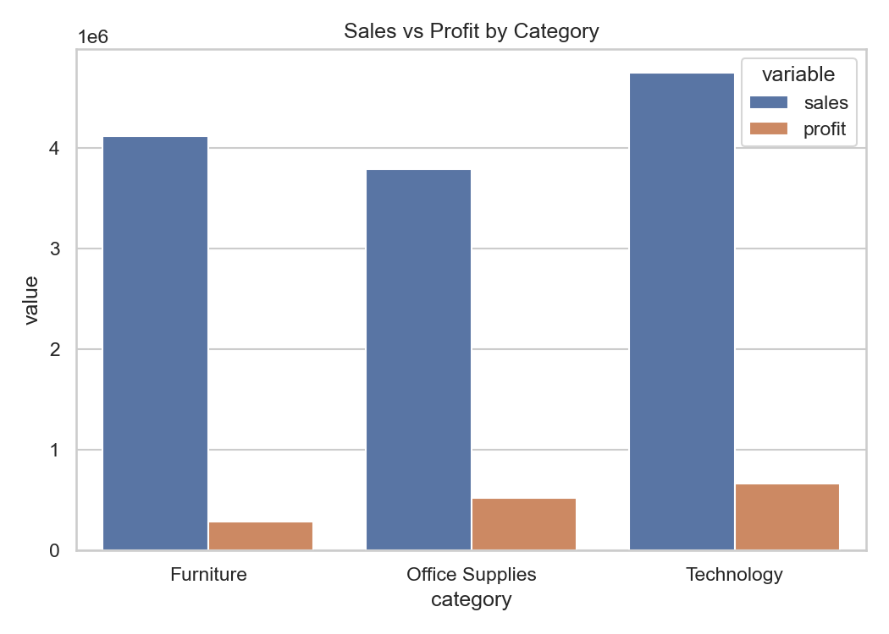
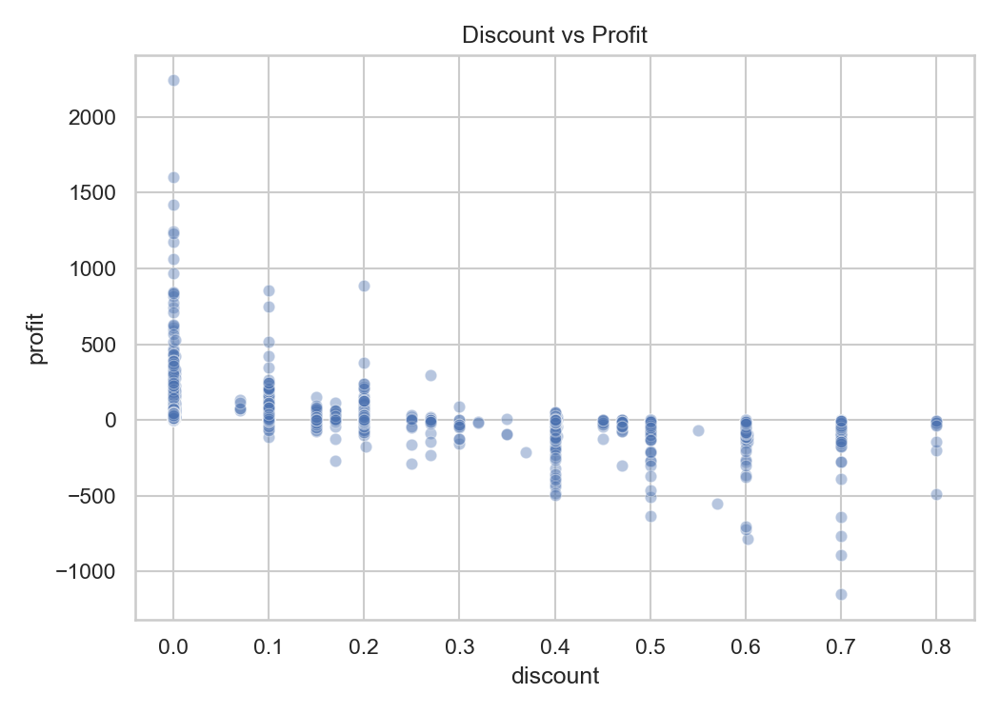
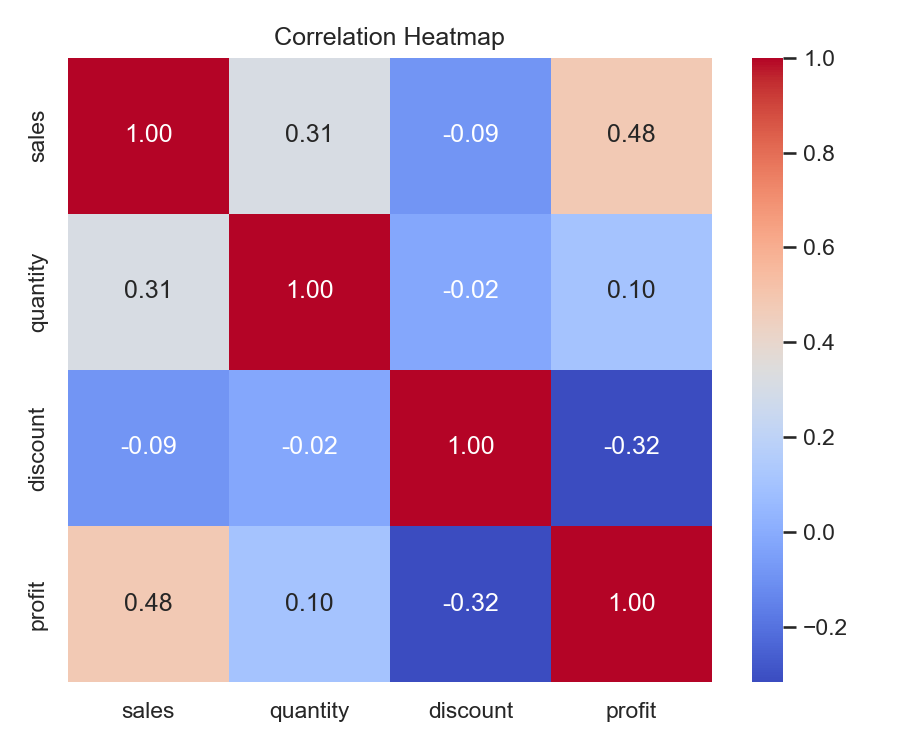
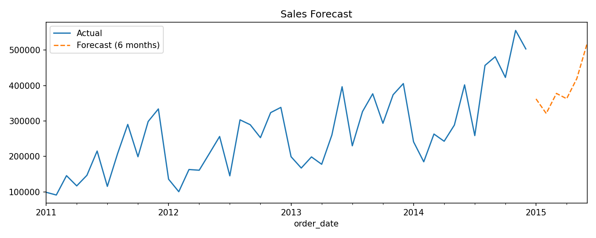

<div align="center">

# 🛒 Retail Sales Analytics — AI-Powered Dashboard

**End-to-end data analysis pipeline with an interactive Streamlit dashboard and AI-powered Q&A**

[](https://python.org)
[](https://streamlit.io)
[](https://plotly.com)
[](#ai-features)
[](LICENSE)

*Analyse 51,000+ retail transactions • Interactive filters • AI-generated insights • Sales forecasting*

---

</div>

## 📋 Table of Contents

- [Overview](#-overview)
- [Key Findings](#-key-findings--kpis)
- [Architecture](#-architecture)
- [Dashboard Features](#-dashboard-features)
- [Charts & Analysis](#-charts--analysis)
- [AI Features](#-ai-features)
- [Project Structure](#-project-structure)
- [Setup & Installation](#-setup--installation)
- [Deployment Guide (Streamlit Cloud)](#-deployment-guide-streamlit-cloud)
- [Tech Stack](#-tech-stack)
- [Future Scope](#-future-scope)

---

## 🔍 Overview

This project analyses the **Global Superstore** dataset (51,290 rows, 2011–2014) through a full data science pipeline:

| Stage | What it Does |
|-------|-------------|
| **Data Cleaning** | Removes duplicates, fixes dates, cleans text, flags outliers (IQR method) |
| **Exploratory Analysis** | KPIs, yearly trends, category/region comparisons, discount impact, RFM segmentation |
| **Visualization** | Static charts (Matplotlib/Seaborn) + interactive Plotly dashboard |
| **Forecasting** | Holt-Winters exponential smoothing → 6-month sales forecast (MAPE: 13.4%) |
| **AI Layer** | Natural language Q&A over data + RAG over documents + auto-generated insights |
| **Dashboard** | Streamlit app with 6 filters, 10+ charts, 5 KPIs, and 3 AI-powered tabs |

---

## 📊 Key Findings & KPIs

| Metric | Value |
|--------|-------|
| **Total Sales** | $12,642,502 |
| **Total Profit** | $1,467,457 |
| **Profit Margin** | 11.61% |
| **Total Orders** | 25,035 |
| **Unique Customers** | 1,590 |
| **Average Order Value** | $504.99 |

### 🔑 Top Insights

1. **Sales Growth**: Consistent YoY growth — $22.6L (2011) → $43.0L (2014), avg ~24% growth/year
2. **Technology leads**: Highest margin (14.0%) vs Furniture (6.9%) — review Furniture pricing
3. **Discount trap**: Discounts >20% destroy margins (21–40% discount → −17.3% margin, 40%+ → −74.1%)
4. **Customer risk**: RFM found 504 "At Risk" customers vs 696 "Champions" — targeted retention needed
5. **Tables bleeding**: Sub-category "Tables" has −7.5% margin with avg 0.30 discount — flag for review

---

## 🏗️ Architecture

```
┌─────────────────────────────────────────────────────────────────────┐
│                        User (Browser)                               │
│  ┌───────────────────────────────────────────────────────────────┐  │
│  │              Streamlit Dashboard (app.py)                     │  │
│  │  ┌──────────┬──────────┬──────────┬──────────┬────────────┐  │  │
│  │  │Dashboard │Deep      │Ask the   │Ask the   │AI Insights │  │  │
│  │  │(KPIs +   │Analysis  │Data (AI) │Project   │(Auto       │  │  │
│  │  │Charts)   │(10 charts│          │(RAG)     │Summary)    │  │  │
│  │  └──────────┴──────────┴────┬─────┴────┬─────┴─────┬──────┘  │  │
│  └─────────────────────────────┼──────────┼───────────┼──────────┘  │
│                                │          │           │              │
│  ┌─────────────────────────────▼──────────▼───────────▼──────────┐  │
│  │                    AI Layer (llm.py)                           │  │
│  │           Groq / Gemini / Claude / Ollama                     │  │
│  └───────────────────────────────────────────────────────────────┘  │
│                                                                     │
│  ┌───────────────────────────────────────────────────────────────┐  │
│  │              Data Pipeline (src/)                             │  │
│  │  01_cleaning → 02_analysis → 03_charts → 04_forecast          │  │
│  └───────────────────────────────────────────────────────────────┘  │
│                                                                     │
│  ┌─────────────────┐  ┌──────────────────┐  ┌────────────────────┐ │
│  │ data/raw/       │  │ data/processed/  │  │ outputs/           │ │
│  │ superstore.csv  │→ │ clean_sales.csv  │→ │ charts/ + tables/  │ │
│  └─────────────────┘  └──────────────────┘  └────────────────────┘ │
└─────────────────────────────────────────────────────────────────────┘
```

---

## 🖥️ Dashboard Features

### 🎛️ 6 Sidebar Filters
All charts and KPIs update dynamically based on filter selection:

| Filter | Options |
|--------|---------|
| **Year** | 2011, 2012, 2013, 2014 |
| **Quarter** | Q1, Q2, Q3, Q4 |
| **Region** | Africa, APAC, Canada, Caribbean, Central, EMEA, EU, LATAM, North, North Asia, Oceania, South, Southeast Asia, US |
| **Customer Segment** | Consumer, Corporate, Home Office |
| **Category** | Furniture, Office Supplies, Technology |
| **Ship Mode** | First Class, Same Day, Second Class, Standard Class |

### 📊 5 Dashboard Tabs

| Tab | Description |
|-----|-------------|
| **📊 Dashboard** | 5 KPIs + 4 interactive charts (trend, category, region pie, discount scatter) |
| **🏆 Deep Analysis** | Sub-category profit ranking, segment analysis, ship mode, quarterly trends, discount bands, top 10 products, yearly growth table |
| **🤖 Ask the Data** | Type any question → AI writes & runs pandas code → shows result + code |
| **📚 Ask Project (RAG)** | Questions answered only from project documents (TF-IDF retrieval) |
| **💡 AI Insights** | Auto-generates 5 insights + 3 business recommendations from filtered data |

---

## 📈 Charts & Analysis

### Monthly Sales Trend
*Consistent upward trend with seasonal peaks in Q4 (holiday season).*



### Category: Sales vs Profit
*Technology leads in profit margin (14%). Furniture has the lowest margin (6.9%) despite comparable sales.*



### Discount vs Profit
*Clear negative relationship — heavy discounts (>20%) almost always result in losses.*



### Correlation Heatmap
*Discount has a −0.316 correlation with profit. Sales and profit are positively correlated (0.49).*



### Sales Forecast (Holt-Winters)
*6-month forecast for Jan–Jun 2015: $362K → $518K. Backtest MAPE: 13.4%.*



---

## 🤖 AI Features

The project supports **4 AI providers** — switch by changing one line in `.env`:

| Provider | Cost | How |
|----------|------|-----|
| **Groq** | Free (rate-limited) | `LLM_PROVIDER=groq` + `GROQ_API_KEY=...` |
| **Google Gemini** | Free (rate-limited) | `LLM_PROVIDER=gemini` + `GEMINI_API_KEY=...` |
| **Claude** | Paid | `LLM_PROVIDER=claude` + `ANTHROPIC_API_KEY=...` |
| **Ollama** | Free (local) | `LLM_PROVIDER=ollama` (runs on your machine) |

### How each AI feature works:

**Ask the Data (text-to-pandas):**
1. AI receives only column names + 3 sample rows
2. It writes pandas code to answer the question
3. Code runs on filtered data in a sandboxed environment (safe builtins only)
4. Result + code shown for transparency / verification

**Ask the Project (RAG):**
1. Documents in `docs/` are split into paragraphs
2. TF-IDF finds the 3 most relevant paragraphs for the question
3. Only those paragraphs are given to the AI — it must answer from them only

**AI Insights (auto-summary):**
1. Dashboard computes rankings and KPIs with pandas
2. Strict rules: AI cannot compare numbers itself or invent causes
3. AI generates 5 key insights + 3 business recommendations

---

## 📁 Project Structure

```
retail-sales-analysis/
│
├── app.py                  # Streamlit dashboard (main entry point)
├── ai_chat.py              # Ask the Data + Auto Insights AI logic
├── rag_chat.py             # RAG — document-based Q&A
├── llm.py                  # Unified LLM interface (Groq/Gemini/Claude/Ollama)
├── list_models.py          # Utility: list available Groq models
├── requirements.txt        # Python dependencies
├── .env.example            # Template for API keys (copy to .env)
├── .gitignore              # .env, venv, raw data excluded
│
├── src/                    # Data pipeline scripts (run in order)
│   ├── 01_cleaning.py      # Raw CSV → cleaned, feature-engineered CSV
│   ├── 02_analysis.py      # KPIs, group-by analysis, RFM segmentation
│   ├── 03_charts.py        # Static PNG charts (Matplotlib + Seaborn)
│   └── 04_forecast.py      # Holt-Winters sales forecast
│
├── data/
│   ├── raw/                # Original dataset (gitignored — too large)
│   │   └── superstore.csv
│   └── processed/          # Cleaned data (included for deployment)
│       └── clean_sales.csv
│
├── outputs/
│   ├── charts/             # Generated chart images (5 PNGs)
│   │   ├── monthly_trend.png
│   │   ├── category.png
│   │   ├── discount_vs_profit.png
│   │   ├── correlation.png
│   │   └── forecast.png
│   └── tables/             # Analysis output CSVs
│       ├── yearly.csv
│       ├── category.csv
│       ├── region.csv
│       ├── discount_impact.csv
│       ├── rfm.csv
│       └── forecast.csv
│
└── docs/                   # Project documentation (used by RAG)
    ├── project_notes.md    # Detailed analysis findings & methodology
    └── data_dictionary.md  # Column definitions & business glossary
```

---

## ⚙️ Setup & Installation

### Prerequisites
- Python 3.10 or higher
- Git

### Steps

```bash
# 1. Clone the repository
git clone https://github.com/payoli-kumari/Retail_Sales_Analytics-Ai.git
cd Retail_Sales_Analytics-Ai

# 2. Create virtual environment
python -m venv venv
# Windows:
venv\Scripts\activate
# Mac/Linux:
source venv/bin/activate

# 3. Install dependencies
pip install -r requirements.txt

# 4. Setup API keys
cp .env.example .env
# Edit .env and add your API key (Groq is free — get key at console.groq.com)

# 5. Run the data pipeline (only needed if you have the raw data)
python src/01_cleaning.py
python src/02_analysis.py
python src/03_charts.py
python src/04_forecast.py

# 6. Launch the dashboard
streamlit run app.py
```

The dashboard opens at **http://localhost:8501** 🎉

---

## 🚀 Deployment Guide (Streamlit Cloud)

Deploy this dashboard for **free** on Streamlit Cloud:

### Step 1: Push to GitHub ✅
*(Already done — you're reading this on GitHub!)*

### Step 2: Go to Streamlit Cloud
1. Visit [share.streamlit.io](https://share.streamlit.io)
2. Sign in with your **GitHub account**

### Step 3: Deploy
1. Click **"New app"**
2. Select repository: `payoli-kumari/Retail_Sales_Analytics-Ai`
3. Branch: `main`
4. Main file path: `app.py`

### Step 4: Add Secrets (API Keys)
1. Click **"Advanced settings"** before deploying
2. In the **Secrets** section, add your keys in TOML format:

```toml
LLM_PROVIDER = "groq"
GROQ_API_KEY = "gsk_your_key_here"
LLM_MODEL = "openai/gpt-oss-120b"
```

3. Click **"Deploy!"**

### Step 5: Done! 🎉
Your dashboard will be live at: `https://your-app-name.streamlit.app`

> **Note:** The dashboard charts work without AI keys. The AI tabs (Ask the Data, Ask Project, AI Insights) need the API key configured in Secrets.

### Updating `llm.py` for Streamlit Cloud

If deploying on Streamlit Cloud, you can optionally update `llm.py` to also read from `st.secrets`:

```python
import streamlit as st

# In llm.py, the existing os.getenv() will work if you set secrets via
# Streamlit Cloud's Advanced Settings → Secrets (TOML format)
```

Streamlit Cloud automatically loads secrets as environment variables, so the existing code works out of the box!

---

## 🛠️ Tech Stack

| Layer | Technology |
|-------|-----------|
| **Language** | Python 3.10+ |
| **Dashboard** | Streamlit |
| **Visualization** | Plotly (interactive) + Matplotlib/Seaborn (static) |
| **Data Processing** | Pandas, NumPy |
| **Machine Learning** | Scikit-learn (TF-IDF, RFM), Statsmodels (Holt-Winters) |
| **AI / LLM** | Groq (free), Google Gemini, Anthropic Claude, Ollama (local) |
| **Environment** | python-dotenv |

---

## 🔮 Future Scope

- [ ] **ChromaDB embeddings** — replace TF-IDF with semantic search for better RAG
- [ ] **KMeans clustering** on RFM scores for richer customer segments
- [ ] **IsolationForest** for anomaly detection in sales data
- [ ] **SQL layer** for database-backed data queries
- [ ] **Ollama local model** integration guide
- [ ] **CI/CD pipeline** with GitHub Actions for auto-testing
- [ ] **Multi-page Streamlit app** for cleaner navigation

---

## 📜 License

This project is open-source under the [MIT License](LICENSE).

---

<div align="center">

**Built with ❤️ by [Payoli Kumari](https://github.com/payoli-kumari)**

*If this project helped you, please ⭐ the repo!*

</div>
